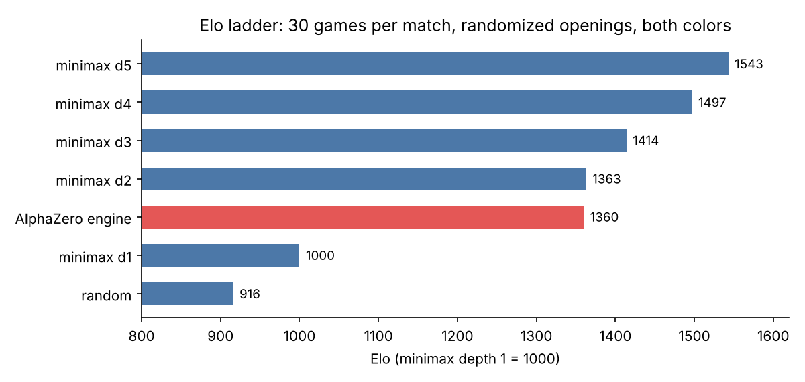
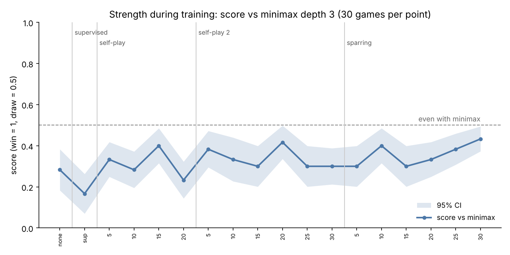

# AlphaZero-Style Checkers

A checkers engine in the style of DeepMind's AlphaZero: a convolutional network with a
**policy head** (which move looks good) and a **value head** (who is winning) guides
**Monte Carlo Tree Search**. The rules engine, network, search, training loop, evaluation
and GUI are written from scratch in Python and PyTorch, and trained on a single laptop CPU.

**Play it in the browser:** _link coming soon_ (code in [`web/`](web/))

## Results

The final model searches **50 positions per move**. Every match below is 30 games from
randomized openings (the first 4 plies are random), with each opening played once as White
and once as Black. Score counts a win as 1 and a draw as 0.5; brackets are 95% intervals.

| Opponent | W–D–L | Score |
|---|---|---|
| Random moves | 26–4–0 | **0.93** [0.87, 0.99] |
| Minimax depth 1 | 26–4–0 | **0.93** [0.87, 0.99] |
| Minimax depth 2 | 1–27–2 | **0.48** [0.43, 0.54] |
| Minimax depth 3 | 3–20–7 | **0.43** [0.33, 0.53] |
| Minimax depth 4 | 0–19–11 | 0.32 [0.23, 0.40] |
| Minimax depth 5 | 0–13–17 | 0.22 [0.13, 0.31] |

A longer run of 100 games each confirms it: **0.48** [0.45, 0.51] vs minimax depth 2 (4–88–8,
even) and **0.36** [0.31, 0.42] vs depth 3 (4–65–31, clearly weaker). Before training, the
same search with random weights scored 0.23 vs random play and 0.00 vs depth 3.

Fitting Elo ratings to all matches (minimax depth 1 anchored at 1000) places the engine at
the level of a **2–3 ply minimax search**:

| Player | Elo |
|---|---|
| Minimax depth 5 | 1543 |
| Minimax depth 4 | 1497 |
| Minimax depth 3 | 1414 |
| Minimax depth 2 | 1363 |
| **AlphaZero engine (this repo)** | **1360** |
| Minimax depth 1 | 1000 |
| Random | 916 |



### Strength during training

Every 5th checkpoint, plus the untrained network, played 30 games against minimax depth 3:



**The curve is flat.** Against depth 3 the score stays between 0.17 and 0.43 for the whole run;
the 95% bands of almost all checkpoints overlap, so most ups and downs are noise. The engine
learned to hold draws but not to convert wins. Two reasons:

1. **The value head collapsed toward zero.** About two thirds of training games were draws, so
   the cheapest way to lower the value loss was to always predict ~0. Probing the final network:
   a position where White is three men up gets a value of −0.04, the same as the start position
   (−0.11). With a flat value, MCTS cannot tell a winning line from a drawn one.
2. **No gating and no replay buffer.** Each new network replaced the previous one without having
   to beat it, and trained only on the latest iteration's 40 games, so strength could drift down
   as easily as up.

Next steps: adjudicate long draws by material, keep a replay buffer, and gate new networks.

## How it works

```
play.py ──► MCTSAgent (training/mcts.py) ──► AlphaCheckersNet (training/model.py) ◄── models/alpha_checkers.pth
               │                                  ▲
               ▼                                  │ trained by
          CheckersGame (game/checkers.py)    train.py → train_v2.py → train_v3.py
                                                  │
                                                  ▼ opponents
                                     agents/random_agent.py, agents/minimax_agent.py
```

**Network** (`training/model.py`). Input: four 8×8 planes (own men, own kings, opponent men,
opponent kings), always from the side to move. Three 3×3 conv layers (64, 128, 128 channels)
with batch norm feed a policy head (200 move logits) and a value head (tanh, −1 to +1).

**Search** (`training/mcts.py`). Each move runs 50 simulations: descend the tree by
$\text{UCB} = Q + c\,P\,\frac{\sqrt{N_{\text{parent}}}}{1+N}$, expand the new leaf with the
network's move priors, back up the network's value with the sign flipped at each level, and
finally play the most-visited move.

**Training** — three stages, 80 iterations in total:

| Stage | Script | What happens | Checkpoints |
|---|---|---|---|
| 1. Imitation | `train.py` | Minimax depth 3 plays 200 games vs random; the network learns to predict its moves and the game outcome | `alpha_supervised.pth` |
| 2. Self-play | `train.py`, then `train_v2.py` | Each iteration: 30–40 self-play games with MCTS, then train on (position, MCTS visit distribution, final result) | `alpha_iter_*.pth`, `alpha_v2_iter_*.pth` |
| 3. Sparring | `train_v3.py` | Same, but half the games are against minimax depth 3 | `alpha_v3_iter_*.pth` |

The three scripts are the three stages run one after another (each loads the previous
stage's `alpha_checkers.pth`), kept separate as they were developed. `models/` contains the
final model and every 5th checkpoint; the full training output is in `training_log*.txt`.

## How the evaluation was fixed

The first version of `evaluate.py` played Alpha (White) against minimax 10 times from the
starting position and reported "all draws". Both players are **deterministic** (MCTS
without noise picks the most-visited move; minimax picks the first best move), so those 10
games were **one game repeated 10 times**, and an untrained network drew that same line too.

`benchmark.py` fixes this: random openings so every game differs, both colors, an
untrained-network baseline, confidence intervals, and an Elo fit across all players.

## Known limitations

- **Move encoding.** `encode_move` maps a move to `(from_square * 4 + direction) % 200`.
  The modulo makes 24 slots shared by two different moves (about 1% of positions have two
  legal moves on the same index), and moves are not flipped for Black although the board is.
  32 dark squares × 4 directions = 128 actions with a flip would fix it, but changes the
  network's output layer, so it needs retraining.
- No Dirichlet noise at the root, no replay buffer across iterations, and no gating (a new
  network replaces the old one without having to beat it).
- Self-play runs in a single process; it is the bottleneck, not the network.
- Draw rule: 40 consecutive plies without a capture.

## Run it

```bash
pip install -r requirements.txt

python play.py alpha 3          # watch the engine vs minimax depth 3
python play.py play_alpha       # play against it yourself (you are White)

python benchmark.py ladder      # Elo ladder vs random and minimax depths 1-5
python benchmark.py curve       # strength of every checkpoint vs minimax depth 3

pip install -r web/requirements.txt
uvicorn web.app:app             # web demo at http://127.0.0.1:8000
```

## Layout

```
game/checkers.py        rules: legal moves, mandatory captures, multi-jumps, kings, draw rule
game/display.py         Pygame board with a live neural evaluation bar
agents/                 random and minimax (alpha-beta) opponents
training/model.py       policy/value CNN, board encoding, move encoding
training/mcts.py        Monte Carlo Tree Search and the MCTS agent
training/train*.py      stage 1-2, stage 2 continued, stage 3
benchmark.py            evaluation: Elo ladder and learning curve
web/                    browser demo: FastAPI + one HTML page, NumPy inference (no PyTorch needed)
models/                 final model and every 5th checkpoint
figures/                benchmark plots and CSVs
```
